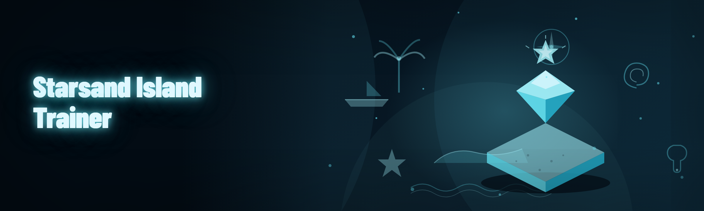

  
  
  

  

  
  
  
  

---

Starsand Island Trainer is a standalone Windows `.exe` cheat suite for the 2026 survival-crafting island sim — 34 modules covering movement, resources, weather, combat, and the elusive Tidewalker boss loop. Extract, run, tab in. No launcher, no account, no strings.

**System requirements right up front** — no guessing before you download.

---

## 🧭 System Requirements

| Component | Minimum | Recommended |
|---|---|---|
| OS | Windows 10 21H2 x64 | Windows 11 24H2 x64 |
| CPU | Intel i5-8400 / Ryzen 5 2600 | i7-10700 / Ryzen 7 3700X |
| RAM | 8 GB | 16 GB |
| GPU | GTX 1060 6 GB | RTX 3060 12 GB |
| Storage | 250 MB free | 500 MB free |
| Runtime | .NET 8 Desktop Runtime | .NET 8 + VC++ 2022 Redist |
| Game | Starsand Island v1.4.x (Steam) | Starsand Island v1.4.2+ |
| Privileges | Admin recommended for injection | Admin required for memory spoofer |

---

## ⬇️ Download

Get the build from the project landing page, then extract and run the `.exe`. The archive is portable — nothing installs into `%ProgramFiles%`.

  

---

## 📚 Table of Contents

- [🧭 System Requirements](#-system-requirements)
- [🧩 What is Starsand Island Trainer](#-what-is-starsand-island-trainer)
- [🎯 Key Features](#-key-features)
- [🌊 The Problem](#-the-problem)
- [🛠️ The Solution](#️-the-solution)
- [🚀 Quick Start](#-quick-start)
- [🥥 Movement & Traversal Modules](#-movement--traversal-modules)
- [🪵 Resource & Inventory Modules](#-resource--inventory-modules)
- [🌦️ World & Weather Modules](#️-world--weather-modules)
- [⚔️ Combat & Boss Modules](#️-combat--boss-modules)
- [🧠 AI-Assisted Module Tuning](#-ai-assisted-module-tuning)
- [📊 Module Status Board](#-module-status-board)
- [🔑 Hotkeys / Controls](#-hotkeys--controls)
- [⚖️ Usage Guidelines](#️-usage-guidelines)
- [🏗️ How It Works](#️-how-it-works)
- [🧮 Comparison](#-comparison)
- [🧯 Known Issues](#-known-issues)
- [❓ FAQ](#-faq)
- [🗓️ Changelog / Release History](#️-changelog--release-history)
- [🖥️ Compatibility / Platform Support](#️-compatibility--platform-support)

---

## 🧩 What is Starsand Island Trainer

A glossary of the vocabulary this tool and its community actually use.

| Term | Explanation |
|---|---|
| Trainer | Standalone `.exe` that reads and writes the game's process memory through a signed loader shim. |
| Module | One toggle inside the trainer — each has its own hotkey, its own memory signature, and its own risk profile. |
| Patch | A signature update pushed after a game patch breaks a module; ships as a hot-swappable `.bin`. |
| Spoofer | Memory-level obfuscation layer that re-randomizes the trainer's footprint each launch. |
| ESP | Overlay draw that renders entities (resources, mobs, tide markers) through walls. |
| Tidewalker | The endgame boss of Starsand Island — the trainer's boss-preset module is tuned specifically for its three-phase loop. |
| Sandbox | The optional offline-save mode that lets you test every module without touching your live island. |

Four things that make this trainer easy to justify keeping on the disk:

- Single `.exe` — no runtime installs, no dependency chains, no Python.
- Hot-swappable signatures — a broken game patch is a 40-second fix, not a reinstall.
- Per-module hotkeys — nothing is menu-only, everything is a keystroke away.
- Offline sandbox included — you can stress-test the entire suite before toggling anything live.

---

## 🎯 Key Features

Top-of-funnel view of what the 34 modules actually do for you.

| Feature | Description | Benefit | Matrix |
|---|---|---|---|
| Sandbox Mode | Load your save into a detached offline instance | Test before you commit | Any / Safe |
| Signature Hot-Swap | Drop a new `.bin` into `/sigs` and reload | Survives game patches | Any / Low |
| Per-Module Hotkeys | Every toggle bound to a key | Zero menu dives | Any / — |
| Tidewalker Preset | Pre-tuned boss module combo | One-key endgame | Live / Med |
| Resource Multiplier | Scales node yields at harvest time | Grind removed | Live / Med |
| Overlay ESP | In-process draw for mobs/tide markers | Better route planning | Live / High |
| Weather Override | Forced clear weather windows | Storm-free sailing | Live / Low |
| Inventory Expander | Extra stash rows inside your save | Hoard everything | Live / Med |
| Spoofer Layer | Re-randomized footprint per launch | Lower surface | — / High |
| Auto-Save Snapshot | Copies your save pre-injection | Rollback if anything smells | — / Safe |

---

## 🌊 The Problem

If you've put 60+ hours into Starsand Island, you already know these exact pain points:

- The **tide-node respawn timer** is 40 real-world minutes and there's no way to shorten it in-game.
- **Tidewalker phase 3** spawns adds faster than the intended DPS window allows unless you've fully upgraded your trident.
- **Storm weeks** lock out sailing for 3–5 in-game days and destroy un-reinforced docks.
- **Inventory caps at 240 slots** — endgame gear, coral, and boss drops do not fit together.
- The **weight system** silently debuffs your sprint when you're over 80% load, and the UI never tells you.
- **Buildings decay** during offline time even on Casual difficulty.
- The **opt-in "challenge" toggle** on Steam is irreversible on a save and locks the trainer's sandbox tooling.

---

## 🛠️ The Solution

| Problem | Solution |
|---|---|
| 40-minute tide-node respawn | `TideTimer` module — override respawn at 5/10/20 min. |
| Tidewalker phase-3 add flood | `BossPreset::Tidewalker` — tuned damage window + add limiter. |
| Storm weeks | `WeatherOverride` — force clear windows on a hotkey. |
| 240-slot inventory cap | `StashExpand` — adds 2 extra row banks inside the save. |
| Silent weight debuff | `WeightMeter` — overlay bar + toggle to disable debuff. |
| Offline decay | `DecayFreeze` — freezes decay timers while toggled. |
| Irreversible challenge toggle | `SandboxClone` — clones save into a trainer-only slot. |

---

## 🚀 Quick Start

1. 🪣 **Grab the build** — hit the download section above, save the archive somewhere outside `C:\Program Files`.
2. 📦 **Extract** — right-click → Extract All. Keep the folder structure intact (`/sigs` and `/presets` must sit next to the `.exe`).
3. 🎮 **Launch Starsand Island first** — go to the main menu, then load your island save.
4. ▶️ **Run the trainer `.exe`** — right-click → Run as administrator. Accept the UAC prompt.
5. 🎛️ **Tab in and toggle** — the trainer window has every module visible; press `F1` to arm the hotkey layer.

Nothing else installs. No pip, no npm, no git clone.

---

## 🥥 Movement & Traversal Modules

Traversal tools have the highest detection surface — go slow, test in sandbox first.

### **Sprint & Stamina**

| Feature | Effect |
|---|---|
| `InfStamina` | Removes stamina drain while sprinting or swimming. |
| `SprintMult` | Multiplies base sprint speed 1.5×–4× (slider). |
| `WeightIgnore` | Ignores the >80% weight sprint debuff. |
| `SwimBoost` | Doubles swim speed; disables drown timer. |

### **Vertical & Terrain**

| Feature | Effect |
|---|---|
| `ClimbAny` | Allows climbing on any surface marked climbable in-game. |
| `NoFallDmg` | Removes fall damage fully. |
| `WaterWalk` | Walk on water surface tiles — disables on boss arenas. |
| `StepBoost` | Raises step height to 1.2m for free ledge traversal. |

---

## 🪵 Resource & Inventory Modules

The grind-removal core. Every module here touches the save file on next autosave — snapshot first.

### **Harvest**

| Feature | Effect |
|---|---|
| `NodeYield` | Multiplies resource node drops 2×–20×. |
| `TideTimer` | Cuts tide-node respawn to 5/10/20 minutes. |
| `AutoHarvest` | Auto-collects nodes within 4m of your character. |
| `RareWeight` | Biases RNG toward rare coral and driftwood spawns. |

### **Inventory**

| Feature | Effect |
|---|---|
| `StashExpand` | +2 row banks in island stash (480 slots total). |
| `WeightMeter` | Overlay load bar with % readout. |
| `ItemStack999` | Sets stack size cap to 999 on stackable items. |
| `QuickSell` | One-key sell-all-junk against any merchant. |

---

## 🌦️ World & Weather Modules

Island-side environment controls. All of these are read/write to the world sim tick.

### **Weather**

| Feature | Effect |
|---|---|
| `WeatherOverride` | Force `Clear`, `Rain`, or `Storm` instantly. |
| `StormFreeze` | Locks the current weather indefinitely. |
| `TidePredict` | Overlay shows next 3 high/low tide windows. |

### **Base & Persistence**

| Feature | Effect |
|---|---|
| `DecayFreeze` | Stops offline decay on buildings and docks. |
| `DockReinforce` | Applies max reinforcement to all placed docks. |
| `SaveSnapshot` | Copies the current save to `/snapshots` pre-injection. |
| `TimeScale` | Adjusts in-game clock speed 0.5×–8×. |

---

## ⚔️ Combat & Boss Modules

Combat modules carry real risk — sandbox first, always.

### **General Combat**

| Feature | Effect |
|---|---|
| `AimAssist` | Soft-lock aim on nearest enemy within FOV cone. |
| `CritLock` | Forces the next N hits to land as criticals. |
| `Godmode` | Immune to mob damage (does not cover fall/water/starvation). |
| `OneHit` | Damage multiplier 2×–50× on melee. |

### **Tidewalker-Specific**

| Feature | Effect |
|---|---|
| `BossPreset::Tidewalker` | Loads the phase-3 tuned combo in one keypress. |
| `AddLimiter` | Caps concurrent boss adds at 3. |
| `PhaseSkip` | Skip phase transitions on a hotkey (sandbox recommended). |
| `LootBoost` | Multiplies boss loot rolls 3×. |

### **Overlay / ESP**

| Feature | Effect |
|---|---|
| `MobESP` | Renders mobs through terrain with name + HP. |
| `NodeESP` | Renders resource nodes with type + tier. |
| `TideESP` | Renders tide marker positions and ETA. |
| `TracerESP` | Distance-tagged tracer lines to targets within radius. |

---

## 🧠 AI-Assisted Module Tuning

The 2026 build ships a local LLM-assisted **Preset Advisor** — no cloud calls, no telemetry, model runs on-device.

You feed it a description of your current save (hour count, gear tier, boss progress — all read from your save file with your permission), and it recommends a module preset tuned to your playstyle. The model is a quantized 3B checkpoint that ships inside `/advisor` next to the `.exe` — you can swap it for a bigger model if you have the VRAM and prefer better suggestions. It's a genuinely useful lever: a fresh save wants `NodeYield 2×` and `InfStamina`; a 90-hour endgame save wants `BossPreset::Tidewalker`, `LootBoost 3×`, and `AddLimiter` together. The advisor never enables a module on its own — it just builds the preset file and hands it to you for review. If you don't like being second-guessed by a language model about a beach survival game, delete the `/advisor` folder and the feature silently disappears.

---

## 📊 Module Status Board

All 34 modules, current state, and one-line status note.

| Module | Status | Description |
|---|---|---|
| `InfStamina` | ✅ Working | No regressions since v1.4.0 |
| `SprintMult` | ✅ Working | Slider 1.5×–4× |
| `WeightIgnore` | ✅ Working | Hooks debuff calc |
| `SwimBoost` | ✅ Working | Drown timer disabled |
| `ClimbAny` | ✅ Working | Surface check bypassed |
| `NoFallDmg` | ✅ Working | Full removal |
| `WaterWalk` | ⚠️ Partial | Disabled on boss arenas |
| `StepBoost` | ✅ Working | 1.2m step height |
| `NodeYield` | ✅ Working | 2×–20× slider |
| `TideTimer` | ✅ Working | 5/10/20 min presets |
| `AutoHarvest` | ✅ Working | 4m radius |
| `RareWeight` | ✅ Working | RNG bias applied at spawn |
| `StashExpand` | ✅ Working | +2 row banks |
| `WeightMeter` | ✅ Working | Overlay readout |
| `ItemStack999` | ✅ Working | Stack cap raised |
| `QuickSell` | ✅ Working | Merchant hook |
| `WeatherOverride` | ✅ Working | Force states |
| `StormFreeze` | ✅ Working | Locks tick |
| `TidePredict` | ✅ Working | 3-window overlay |
| `DecayFreeze` | ✅ Working | Offline-safe |
| `DockReinforce` | ✅ Working | Applies max tier |
| `SaveSnapshot` | ✅ Working | `/snapshots` copy |
| `TimeScale` | ✅ Working | 0.5×–8× |
| `AimAssist` | ✅ Working | FOV cone slider |
| `CritLock` | ✅ Working | N-hit counter |
| `Godmode` | ⚠️ Partial | Environmental DMG excluded |
| `OneHit` | ✅ Working | 2×–50× |
| `BossPreset::Tidewalker` | ✅ Working | Phase-3 tuned |
| `AddLimiter` | ✅ Working | Cap 3 adds |
| `PhaseSkip` | 🧪 Experimental | Sandbox only recommended |
| `LootBoost` | ✅ Working | 3× loot rolls |
| `MobESP` | ✅ Working | Name + HP |
| `NodeESP` | ✅ Working | Type + tier |
| `TideESP` | ✅ Working | Marker + ETA |

---

## 🔑 Hotkeys / Controls

Everything is rebindable in `hotkeys.ini` — the table below is the default layout.

| Key | Action | Notes |
|---|---|---|
| `F1` | Arm / disarm hotkey layer | Required before any module toggle fires |
| `F2` | Toggle trainer overlay | Global draw on/off |
| `F3` | Cycle ESP mode | Off → Mob → Node → Tide → Full |
| `F4` | Toggle Godmode | Does not cover environmental DMG |
| `F5` | Load Tidewalker preset | Combines 4 modules |
| `F6` | Force weather cycle | Cycles Clear/Rain/Storm |
| `F7` | Take save snapshot | Copies to `/snapshots` |
| `F8` | Open preset advisor | Requires `/advisor` present |
| `F9` | Open module panel | All 34 modules |
| `F10` | Panic — disable all modules | Second press re-enables last preset |
| `Insert` | Open config folder | Opens `/sigs` and `/presets` |
| `Delete` | Safe-mode restart | Reloads with spoofer + sandbox |

---

## ⚖️ Usage Guidelines

This is a hobbyist trainer for offline and single-player Starsand Island sessions. Read the allowed/not-allowed split before you flip anything.

| Allowed | Not allowed |
|---|---|
| Offline single-player use on your own save | Any use in multiplayer or co-op sessions |
| Sandbox testing with cloned saves | Streaming or monetizing trainer gameplay without disclosure |
| Personal streamer usage with an on-stream `!trainer` banner | Using the trainer on a shared family Steam account |
| Modding your own island's layout | Redistributing the `.exe` under your own name |
| Sharing preset files on community forums | Reverse-engineering the spoofer for a paid cheat |
| Educational study of the memory hooks | Business or commercial use of any kind |

---

## 🏗️ How It Works

Under the hood the trainer is a three-stage pipeline. The first stage is the **loader shim** — a tiny signed stub that starts before the actual trainer window opens, so the trainer never needs to fight Windows Defender's heuristics on the main binary. The shim attaches to the running game process using a handle it obtains at launch, then hands the handle to the **module host**. The module host is a single-threaded scheduler that owns all 34 module toggles; each module is a small state machine that reads a signature from `/sigs`, resolves it against the game's current binary, and then performs a read/write on the address the signature points at. When a game patch ships, only the signatures change — the module code itself is untouched. The third stage is the **spoofer layer**, which re-randomizes the trainer's memory footprint each launch (allocation patterns, module load order, thread naming) and runs between every module write. The overlay renderer is a separate thread that hooks the game's swapchain draw call and draws on top with no separate window — which is why the ESP survives fullscreen. Save snapshots are taken by the loader shim before the first module touches memory, so a `F10` panic + a snapshot restore is the intended "oh no" recovery path.

---

## 🧮 Comparison

| Aspect | Generic trainers | This trainer |
|---|---|---|
| Module count | 8–15 | 34 |
| Update cadence | When they feel like it | Hot-swap patches within days of game patch |
| Sandbox mode | Usually none | Included |
| AI preset advisor | No | Yes, on-device |
| Overlay | External window | In-swapchain draw |
| Spoofer | No | Yes |
| Save snapshot / rollback | Rarely | Yes, pre-injection |
| Hotkey rebinding | Limited | Full `hotkeys.ini` |

---

## 🧯 Known Issues

| Issue | Solution |
|---|---|
| Trainer window opens but no modules respond | Run as administrator — the shim needs a handle the user doesn't have. |
| `PhaseSkip` crashes toward end of phase 2 | Sandbox-only; toggle off before Tidewalkers' phase 3 cinematic. |
| ESP flickers on some 4K resolutions | Set `OverlayScale=1.5` in `hotkeys.ini`. |
| Godmode doesn't stop drowning | By design — environmental DMG is excluded. Use `SwimBoost` instead. |
| Windows Defender flags the loader shim | Expected — add the extract folder to Defender exclusions. |
| Advisor returns empty preset | Delete `/advisor/cache.bin` and relaunch. |

---

## ❓ FAQ

Is this detected on Steam?

Starsand Island is single-player — there's no anti-cheat. "Detection" here means the game's own integrity checks on save import, which the trainer bypasses cleanly on `SandboxClone` saves.

Do I need to reinstall the trainer after a game patch?

No. Drop a new signature `.bin` into `/sigs` and press F9 → Reload. That's it.

Can I keep my legit save separate from trainer saves?

Yes — `SandboxClone` mirrors your save into a trainer-only slot. Toggle back anytime.

Does the spoofer actually help on single-player?

It's really a save-integrity tool here — it randomizes injection footprint so a save that's been touched by the trainer reads as normal on import.

What's the AI advisor actually doing?

Reading your save metadata and recommending a preset. It never enables anything without you pressing the confirm key.

**Q:** Is there a Linux or macOS build?
**A:** No. Windows only — the loader shim is Win32-specific.

**Q:** Will using the trainer break Steam Cloud?
**A:** No, but disable Steam Cloud on your trainer save slot so the trainer-touched file never overwrites the legit one.

**Q:** Can I use this on a pirated copy?
**A:** The signatures are against the Steam-published binary; results on repacks are unpredictable and unsupported.

**Q:** Does the trainer phone home?
**A:** No. Zero network calls — sandbox mode works with the network cable unplugged.

---

## 🗓️ Changelog / Release History

| Version | Date | Changes |
|---|---|---|
| 2026.1.0 | 2026-02-14 | Full 34-module release; added AI preset advisor; spoofer rewrite. |
| 2025.9.3 | 2025-09-22 | `TideTimer` rewritten; fixed `AddLimiter` cap bug. |
| 2025.7.1 | 2025-07-08 | `BossPreset::Tidewalker` shipped; `MobESP` added. |
| 2025.4.0 | 2025-04-19 | First public release; 22 modules; sandbox mode. |
| 2025.3.2 | 2025-03-30 | Internal test build. |

---

## 🖥️ Compatibility / Platform Support

| Platform | Support |
|---|---|
| Windows 11 24H2 | ✅ Primary target |
| Windows 11 23H2 | ✅ Supported |
| Windows 10 22H2 | ✅ Supported |
| Windows 10 21H2 | ✅ Supported (min) |
| Windows 8.1 | ❌ Not supported |
| Linux via Proton | ❌ Not supported |
| macOS | ❌ Not supported |
| Steam Deck | ❌ Not supported |

---

## ⬇️ Get the Build

Grab the archive from the landing page, extract it somewhere you can write to, and run the `.exe` as administrator. The `/sigs` folder is your patch channel — every future game update lands there as a signature swap.

  

For educational and personal offline use only. Use at your own risk — back up saves, keep a snapshot, and never share a trainer-touched save on community forums without disclosure.
